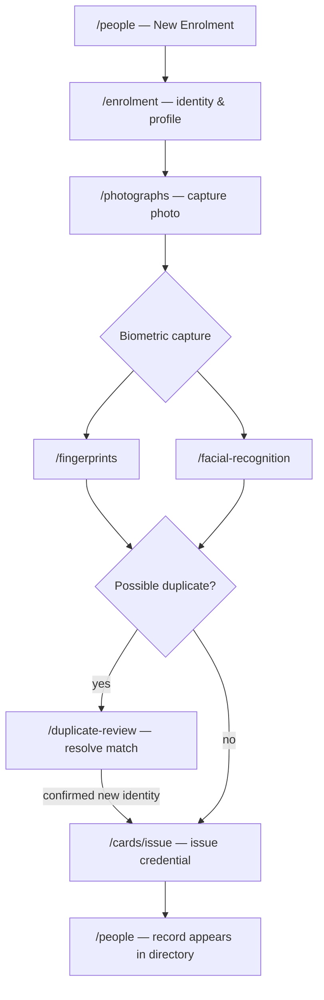
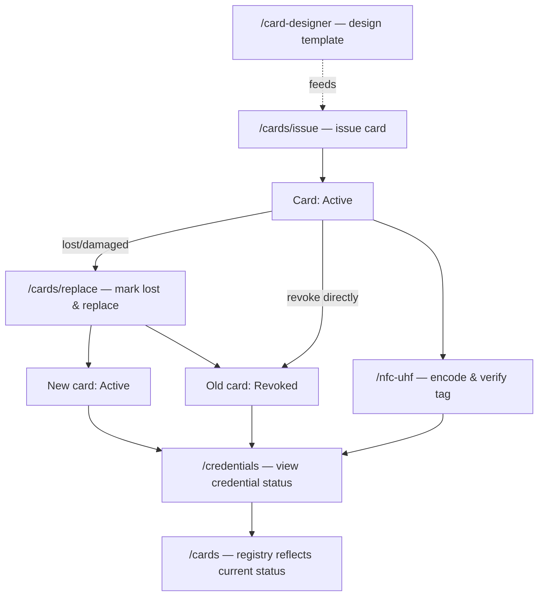
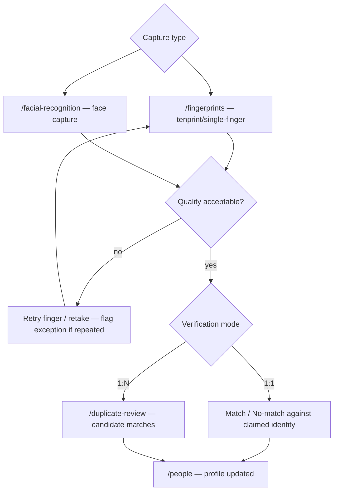
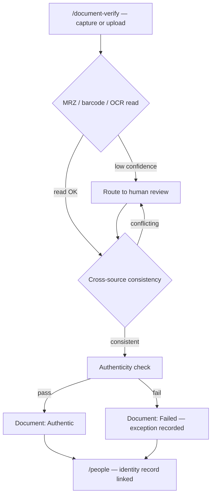

# BIO-UX-003 — Create complete page inventory, route manifest and interaction map

As the product owner, every major BIOLOG screen and action is mapped before feature coding, so the
whole experience can be reviewed early.

This story is primarily a design-record deliverable: `web/lib/route-manifest.ts` (new, typed and
tested) plus the journey diagrams and state-contract notes below. It does not add new routes —
every route it documents already exists and renders (BIO-UX-002) — and it makes no shell/component
changes.

## Acceptance criteria

| AC | Requirement | Implementation | Tests |
|---|---|---|---|
| **AC01** | Route manifest covers the named page families | `web/lib/route-manifest.ts`'s `ROUTE_MANIFEST` (31 entries) | `bio-ux-003-route-manifest.test.ts` "covers every named page family" |
| **AC02** | Each route identifies primary/secondary actions, required visibility, target service port | Every `RouteManifestEntry`: `primaryActions`, `secondaryActions`, `requiredPermission`, `servicePort` (including explicit `'Unassigned'` with a note, never silently omitted) | `bio-ux-003-route-manifest.test.ts` AC02 block |
| **AC03** | Empty/loading/permission-denied/error/offline/success states defined per major page family | `STANDARD_PAGE_STATES` applies to every entry by default; the 4 static/form pages that genuinely don't need the full set narrow it explicitly, each with a note | `bio-ux-003-route-manifest.test.ts` AC03 block |
| **AC04** | Cross-page journeys diagrammed: enrolment, card lifecycle, biometric verification, document verification | 4 Mermaid diagrams below | Manual doc review — a diagram has nothing to unit-test; the routes it references are cross-checked against `ROUTE_MANIFEST_HREFS` by inspection below |
| **AC05** | No primary nav item points to an intentionally non-functional page | Every `PRIMARY_NAV_ITEMS` href resolves to a real `page.tsx` on disk (mechanically checked, not assumed) and is covered by the manifest | `bio-ux-003-route-manifest.test.ts` AC05 block |

## Two ambiguities resolved (flagged in BIO-UX-002's evidence, resolved here)

### Visitors vs. "Visitor Management"

`PRODUCT-EXPERIENCE.md`'s page-family list names both "Visitors" (as part of the People/Students/
Staff/Visitors/Alumni/Contractors identity-type group) and, later, "Visitor Management" (grouped
with Access/Attendance/Transport/Devices as an operational area). **This story's own AC01 — the
authoritative list for this specific deliverable — names only "Visitors," once.** Combined with
`governance/ui-integration-map.json` defining exactly one route for this domain
(`VisitorService` → `/visitors`), the resolution is: one page family, one route, covering both the
visitor identity record and check-in/out actions (`ROUTE_MANIFEST`'s `visitors` entry lists both as
primary/secondary actions). If a real operational distinction later requires a second route (e.g. a
dedicated check-in kiosk view), that is a new story's scope decision, not a gap in this one.

### `/alumni`, `/contractors`, `/nfc-uhf` have no backend-port mapping

Confirmed by re-reading `governance/ui-integration-map.json` in full: none of the three appear
anywhere in it, under any port. All three are legitimately required page families (`/alumni` and
`/contractors` are shown as their own rows in the approved reference screenshot's IDENTITY group;
`/nfc-uhf` is named explicitly in `PRODUCT-EXPERIENCE.md` and shown in the same screenshot's
CREDENTIALS group), so the routes stay. `ROUTE_MANIFEST` marks their `servicePort` as the explicit
`'Unassigned'` value (never silently missing — `bio-ux-003-route-manifest.test.ts` enforces every
`Unassigned` entry carries a note), with each note stating the most likely eventual owner
(`IdentityService` for the first two, `CredentialService` for the third) without asserting it as
fact. Assigning the real port is a governance/backend decision — updating
`governance/ui-integration-map.json` itself is Kemi's call, not this frontend story's to make
unilaterally.

### Dashboard route: `/` vs. `/dashboard`

A third, smaller discrepancy found while building the manifest: `ui-integration-map.json`'s
`ReportingService` entry lists `/dashboard` as a route, distinct from the shell's actual home route
(`/`, working since BIO-FND-007). Resolved to `/` — the real page — with a note on the `dashboard`
manifest entry flagging the map's `/dashboard` as likely needing correction, rather than creating a
second, duplicate dashboard route to satisfy the map literally.

## Cross-page journeys (BIO-UX-003-AC04)

Every route named below exists in `ROUTE_MANIFEST_HREFS`. Diagrams show the intended production
flow (per the approved `BIO-UX-006`–`BIO-UX-011` story ACs), not today's literal placeholder
buttons — matching this manifest's own `primaryActions` framing.

### Enrolment



### Card lifecycle



### Biometric verification



### Document verification



## Local development / verification

```sh
corepack pnpm --dir web typecheck   # passes — route-manifest.ts adds no runtime dependency
corepack pnpm --dir tests/frontend test:unit   # includes bio-ux-003-route-manifest.test.ts (11 tests)
```

No route, component or shell file changed — `web build`/Playwright evidence is inherited unchanged
from BIO-UX-002 (re-run as part of this story's evidence for completeness, not because anything
user-visible changed).
